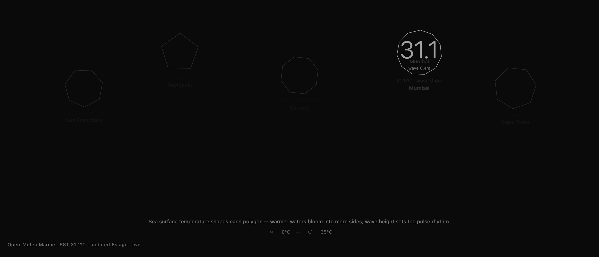

<div align="center">

<h1>morph</h1>

<p><b>Five coastlines, drawn as breathing polygons.</b></p>

<p><i>Warmer sea grows more sides; bigger waves quicken the pulse.</i></p>

<h6>


</h6>

<a href="https://parthchandak02.github.io/morph/"><b>Live demo</b></a> ·
<a href="#how-it-works"><b>How it works</b></a> ·
<a href="#run-it"><b>Run it</b></a>

<br><br>

<a href="https://parthchandak02.github.io/morph/"></a>

<sub>Live capture, 22 October 2026, with Mumbai selected. Real forecast data.</sub>

</div>

<br>

San Francisco, Reykjavik, Sydney, Mumbai and Cape Town each get one outlined polygon on a
near-black field. The page asks the [Open-Meteo Marine API](https://open-meteo.com/en/docs/marine-weather-api)
for today's maximum sea surface temperature and maximum wave height at each city, and turns
them into shape and rhythm: icy Reykjavik is a pentagon, the Arabian Sea off Mumbai an
eleven-sided near-circle. Data refreshes every two minutes. No API key is needed.

## How it works

| Open-Meteo Marine field (today) | Drives |
|---|---|
| `sea_surface_temperature_max` | Number of sides: 0 °C gives a triangle, 35 °C gives 12 sides |
| `wave_height_max` | Breathing and rotation speed: 0 m is a 3-second cycle, 8 m or more is 0.8 seconds |

Each polygon slowly rotates and swells by about 12% on its own cycle, so the five drift in and
out of step. Under each one a small label gives its temperature, wave height and city.

Click or tap a polygon to select it: it brightens, scales up, shows its temperature as a large
number in the middle, and the others dim. After three seconds idle it fades back. The stamp
bottom-left shows the mean temperature of all five cities, or the selected city's, and reads
`live` when all five answered, `3/5 live` when only some did (the rest keep built-in typical
values), or `fallback` when none did.

## Run it

```bash
git clone https://github.com/parthchandak02/morph.git
cd morph
python3 -m http.server 8000   # then open http://localhost:8000
```

One HTML file with no build step and no libraries. Cities, layout, mapping ranges and colours
live in the `C` and `P` objects at the top of the script; [brief.md](brief.md) is the original
creative brief with the full data-to-visual encoding.

<br>

<div align="center">
<sub>Built with Canvas 2D in a single HTML file. Data from Open-Meteo Marine.</sub>
</div>
